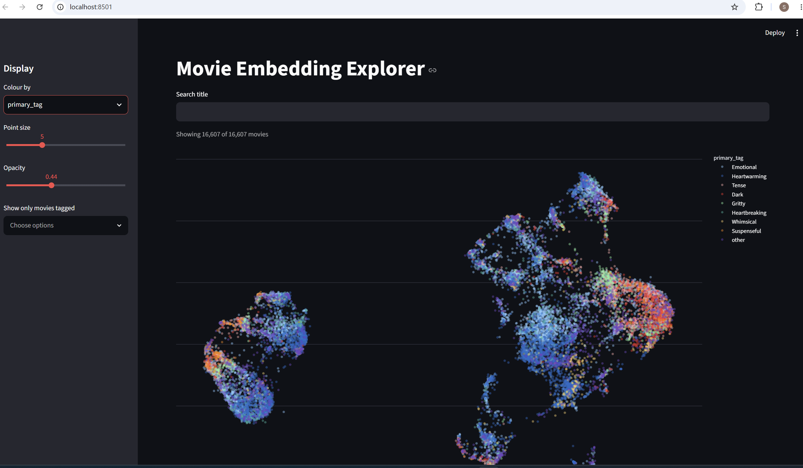

# Movie Embedding Explorer

Exploratory analysis of ~16,600 movie embeddings (1536-D) stored in PostgreSQL with **pgvector**: export the vectors, project them to 2-D with **PCA → UMAP**, find clusters with **HDBSCAN**, measure embedding quality, and browse the result in an interactive **Streamlit** app.

## What it does


| Step | Script | Output |
|------|--------|--------|
| 1. Export | `extract_embeddings.py` | Streams vectors and metadata out of pgvector with a server-side cursor → `output/embeddings.npy`, `output/movies_metadata.csv` |
| 2. Reduce | `reduce_embeddings.py` | PCA (1536 → 50 dims) then UMAP (cosine) to 2-D; optional HDBSCAN clusters named by tag lift → `output/movies_2d.csv` |
| 3. Evaluate | `quality_report.py` | Integrity, norms, anisotropy, effective dimensionality, hubness, semantic alignment and sequel-retrieval checks |
| 4. Explore | `app.py` | Streamlit scatter plot (WebGL) with search, tag filters, colour-by options and nearest-neighbour lookup |

## Tech stack

Python · PostgreSQL + pgvector · psycopg 3 · NumPy · pandas · scikit-learn (PCA, HDBSCAN) · umap-learn · SciPy · Plotly · Streamlit

## Getting started

### Prerequisites
- Python 3.10+
- A PostgreSQL database with the `pgvector` extension and a `wiki_vector_store` table containing `id`, `metadata` (JSONB with `title`, `movieRating`, `tags`) and `embedding` (`vector`) columns

### Setup
```bash
git clone https://github.com/<your-username>/vector-analysis.git
cd vector-analysis

python -m venv .venv
# Windows: .venv\Scripts\activate    macOS/Linux: source .venv/bin/activate
pip install -r requirements.txt

cp .env.example .env    # then fill in your database credentials
```

### Configuration
Credentials are read from environment variables (via `python-dotenv`). See `.env.example`:

| Variable | Description |
|----------|-------------|
| `DB_HOST` | Database host |
| `DB_PORT` | Database port (default `5432`) |
| `DB_NAME` | Database name |
| `DB_USER` | Database user |
| `DB_PASSWORD` | Database password |

`.env` is git-ignored. Never commit real credentials.

### Run the pipeline
```bash
python extract_embeddings.py                 # 1. export from pgvector
python reduce_embeddings.py --cluster        # 2. PCA -> UMAP (+ HDBSCAN)
python quality_report.py                     # 3. embedding quality report
streamlit run app.py                         # 4. open the explorer
```

Useful flags for `reduce_embeddings.py`:
- `--no-seed` runs UMAP multi-threaded (faster, but not reproducible)
- `--n-neighbors`, `--min-dist` tune the UMAP layout
- `--min-cluster-size`, `--min-samples` tune HDBSCAN
- `--pca-dims 0` skips PCA pre-reduction

## Findings and design notes

- **Similarity floor:** random unrelated pairs in this corpus average a cosine similarity of about 0.37, so retrieval thresholds should be set relative to that baseline, not to 0.
- **PCA before UMAP:** reducing to 50 dims keeps ~50% of the variance, drops most of the noise directions and makes UMAP much faster without changing neighbourhoods.
- **Clusters are found in PCA space**, not on the 2-D UMAP coordinates, because UMAP distorts density.
- **Reading the plot:** UMAP preserves local neighbourhoods only. Distances between clusters and cluster sizes are layout artefacts.
- **Row alignment:** `embeddings.npy` and the metadata CSV are aligned by position, so the export query's `ORDER BY id` is required.

## Project structure
```
.
├── app.py                  # Streamlit explorer
├── db.py                   # pgvector connection helper (reads .env)
├── extract_embeddings.py   # export vectors + metadata
├── reduce_embeddings.py    # PCA -> UMAP projection, HDBSCAN clustering
├── quality_report.py       # embedding quality diagnostics
├── test_db.py              # quick connectivity check
├── requirements.txt
├── .env.example
└── output/                 # generated data (git-ignored, ~100 MB)
```

Generated files in `output/` are not committed because `embeddings.npy` alone is ~100 MB. Re-create them by running steps 1–2.
